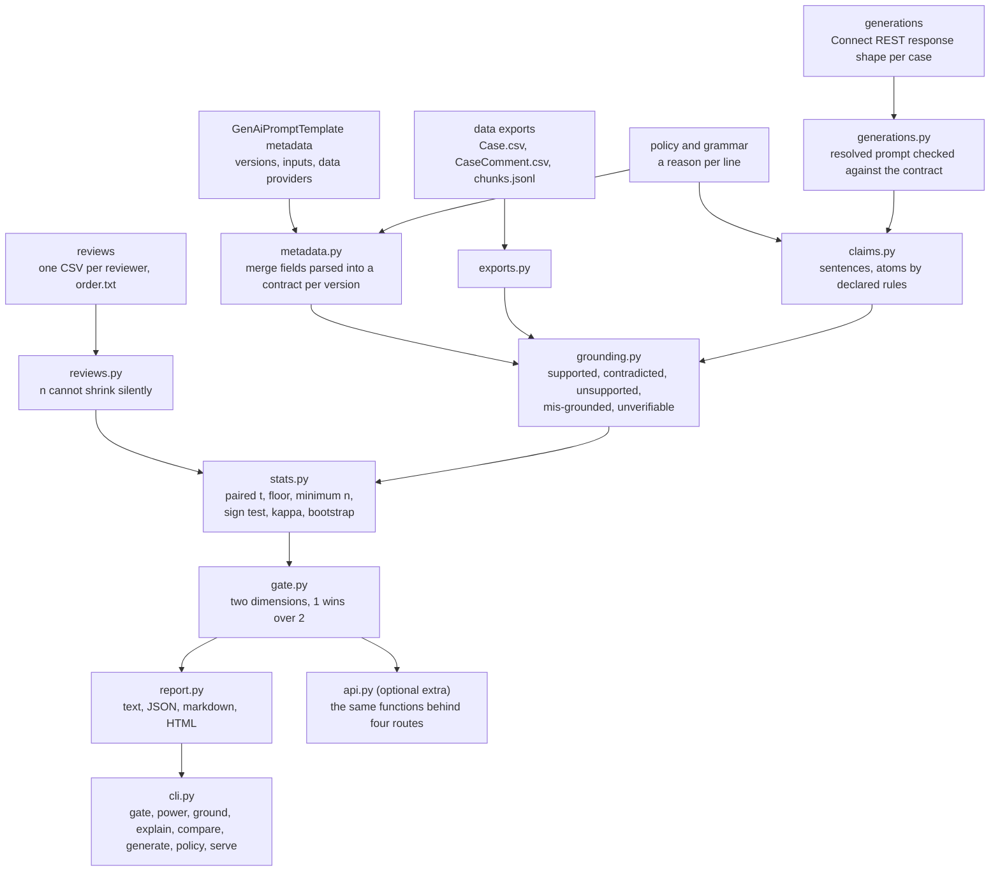
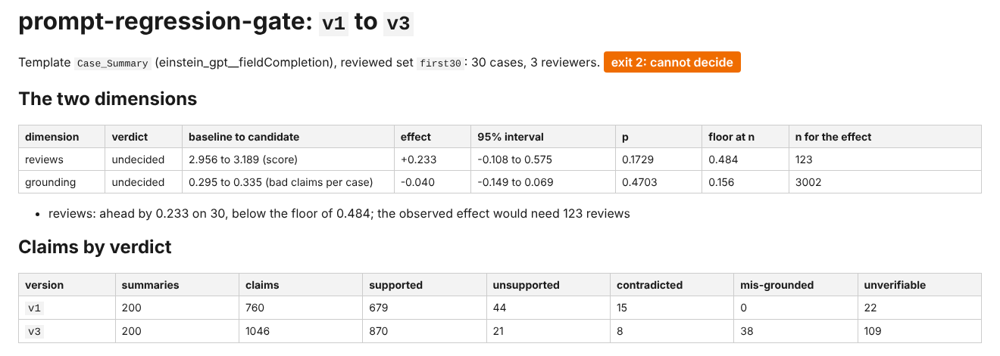
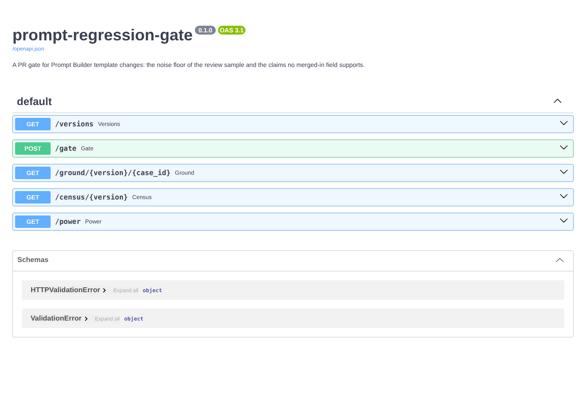

# prompt-regression-gate

**Reads a committed Prompt Builder template in its versions, the summaries each version generated and the hand reviews, and gates a prompt change on two numbers the review score cannot give: whether the candidate's higher score clears the noise floor of the review sample, and how many of its claims no field the template merged in supports.** Offline, no model, no key, no runtime dependencies on the default path. Python 3.11 or later.

[](https://github.com/ManojKumarChunduru/prompt-regression-gate/actions/workflows/ci.yml)

## The thing thirty reviews cannot tell you

A prompt change that scores higher on thirty hand-reviewed case summaries cannot be told from noise, because the difference between two versions on thirty paired reviews has a confidence interval wider than the difference itself whenever the reviewers disagree with each other by about as much as the versions differ, and the arithmetic says how many reviews it would take. The review score also cannot see a claim the case does not support: a reviewer reads the summary and not the resolved prompt, and a fluent sentence with a wrong amount scores as well as a right one unless the reviewer happens to check it. The tool computes the minimum detectable effect at the review sample size (the noise floor), the minimum sample at which the observed difference would clear it, and the count of claims that no merged field, related comment, data provider or retrieved chunk supports, over every generation and not only the thirty.

Four questions this answers that a review sheet and a Prompt Builder preview do not:

1. The candidate scores higher than the active version on the reviewed cases: by more than the noise floor of that sample, and if not, how many reviews would it take?
2. Of the claims in every generated summary, which does the resolved prompt support, which does a field contradict, which came from nowhere, and which came from a retrieved passage about another product?
3. Which bad claims did the reviewers rate without flagging, and does the version they prefer carry more of them?
4. For every ordered pair of versions, at thirty reviews and at two hundred, what does the gate say, and when does a demonstrated regression override an undecided score?

## The numbers, uncomfortable ones first

On the committed fixture (200 cases in the fixture with 597 case comments and 600 retrieved chunks, 3 template versions of one `Case_Summary` template, 600 generated summaries from a stand-in model, 3 reviewers scoring every summary in 1800 review rows, a canonical set of 30 cases):

- **The careful rewrite (v3) is ahead of the active version on the canonical thirty and the thirty cannot say so: careful rewrite ahead by 0.233 on thirty, below a careful floor of 0.484, careful p of 0.173 on thirty. The careful formula says 123 reviews would be needed for that effect; along the committed order the careful rewrite clears at 70 reviews, and on the full review it is careful rewrite ahead by 0.248 on the full review (careful p of 0.00013 on the full review). Of 500 draws of thirty from the full review, 24.8% of careful rewrite thirties clear alpha and 5.8% of careful rewrite thirties point the wrong way.**
- **The fluent rewrite (v2) is the one reviewers prefer, and the gate blocks it: fluent rewrite ahead by 0.456 on thirty and fluent rewrite ahead by 0.267 on the full review, with 0.210 more bad claims per case than v1 (101 bad claims in v2 against 59 bad claims in v1). v2 summaries with a contradicted claim score 3.348 and clean v2 summaries score 3.342: the reviewers cannot see the difference.**
- **84 bad claims no reviewer flagged, 37.0% of bad claims unflagged, out of 227 bad claims in all across 2704 claims extracted; 38 mis-grounded through a chunk on the retriever version, where the retrieved passage was about another product.**
- The reviewers disagree with each other by 0.860 points between reviewers on one summary, which is the size of the effects under test; 41.1% pairwise reviewer agreement on which version is better, mean kappa of 0.105.
- 238 unverifiable claims (8.8% of claims unverifiable) have nothing checkable in them and are counted, never gated on.

Credibility line: 293 tests, 99.0% line coverage, 227 of 227 faults recovered with 0 false positives and 0 false negatives on a fixture the author wrote (floor 1 in 227). Every figure in this document is re-measured by `make verify` and checked against the prose by `tools/check_numbers.py`. The summaries and the reviews are declared fictions: a seeded stand-in model with a stated fault model and a stated reviewer model, so that the review nobody does (all two hundred cases) exists and the thirty can be measured against it. [What this cannot measure](#what-this-cannot-measure) says which claims need a real model and real reviewers.

## Quickstart

Prerequisites: Python 3.11 or later, git, make. No model, no API key, no network after `pip install`, no socket at any point on the default path.

```bash
git clone https://github.com/ManojKumarChunduru/prompt-regression-gate.git
cd prompt-regression-gate
pip install -e ".[dev]"
prg gate --project fixture --baseline v1 --candidate v3                      # exits 2: the thirty cannot decide
prg gate --project fixture --baseline v1 --candidate v3 --reviewed-set all   # exits 0: the full review can
prg gate --project fixture --baseline v1 --candidate v2 --reviewed-set all   # exits 1: preferred, and blocked on grounding
prg power --project fixture --baseline v1 --candidate v3 --sweep
prg explain 500000000000004AAA v3 --project fixture
make verify          # lint, tests with coverage, experiments, receipts
```

Against a real template, retrieve it with the Salesforce CLI (`sf project retrieve start -m GenAiPromptTemplate:Case_Summary`), export the cases and comments with `sf data query --result-format csv`, write the generations in the Connect REST response shape (the `PromptGateProbe` Apex class in the fixture's source does that from an org, or `prg generate --adapter openai|gemini` does it with a key), put the review sheet beside them, and run the same commands. The gate refuses anything it cannot place, with the file and element named.

## Claim 1: the verdict is a sample-size claim, not a score

The review dimension pairs the candidate against the baseline per reviewed case on the mean of the reviewers and runs a paired t test at the policy's alpha ([ADR-001](docs/adr/ADR-001-the-verdict-is-a-sample-size-claim.md)). Beside the p it publishes the noise floor, the smallest paired difference that sample size clears at alpha with the declared power, and the minimum n at which the observed difference would clear it. The grounding dimension is the same arithmetic over the count of bad claims per case, on every generated case and not only the reviewed ones. A dimension is better, worse or undecided; the gate ships only when the reviews are better and the grounding is not worse, blocks when either is worse, and otherwise cannot decide ([ADR-004](docs/adr/ADR-004-a-regression-wins-and-the-service-cannot-disagree.md)).

| Pair | Reviewed | Effect (candidate minus baseline) | Floor at that n | p | Reviews the formula asks for | Clears along the committed order at |
| --- | --- | --- | --- | --- | --- | --- |
| v1 to v3, the careful rewrite | thirty | careful rewrite ahead by 0.233 on thirty | careful floor of 0.484 | careful p of 0.173 on thirty | careful formula says 123 reviews | careful rewrite clears at 70 reviews |
| v1 to v3 | all | careful rewrite ahead by 0.248 on the full review | | careful p of 0.00013 on the full review | | |
| v1 to v2, the fluent rewrite | thirty | fluent rewrite ahead by 0.456 on thirty | fluent floor of 0.453 | fluent p of 0.007 on thirty | fluent formula says 30 reviews | fluent rewrite clears at 23 reviews |
| v1 to v2 | all | fluent rewrite ahead by 0.267 on the full review | | fluent p of 0.00002 on the full review | | |
| v2 to v3 | thirty | v3 against v2 trails by 0.222 on thirty | sibling floor of 0.515 | sibling p of 0.221 on thirty | sibling formula says 153 reviews | never |
| v2 to v3 | all | v3 against v2 trails by 0.018 on the full review | | sibling p of 0.763 on the full review | | |

The careful rewrite is the headline: the thirty puts its effect inside an interval that includes zero (careful interval from minus 0.108 to 0.575), the careful sign test 15 wins, 12 losses, 3 ties says the same, and the formula asks for about four times the reviews a team has. The fluent rewrite clears the thirty by three thousandths of a point over its floor (fluent interval from 0.136 to 0.775, fluent sign test 16 wins, 7 losses, 7 ties), which is what a thirty that happened to be drawn well looks like; the next section says how often that happens. The sibling pair is a true near-tie: a sibling paired spread of 0.972 against an effect the full review puts at two hundredths, and sibling sign test 11 wins, 14 losses, 5 ties.

The minimum n is computed on the central t quantiles iterated to a fixed point, not the noncentral t; the clearing n measured along the committed order is published next to it so the approximation's error is a number (careful formula says 123 reviews, careful rewrite clears at 70 reviews; the formula asks for power, the committed order needed only luck). The careful paired spread of 0.914 and fluent paired spread of 0.855 are the reviewers' disagreement with each other (0.860 points between reviewers on one summary) more than the versions' disagreement with each other.

## Claim 2: thirty reviews point the wrong way often enough to matter

The fixture pays for the review nobody does: every one of the two hundred cases is scored by every reviewer for every version, so a thirty can be measured against the full review rather than trusted. Experiment 2 draws 500 draws of thirty from the full review with a seeded generator and asks each what it would have concluded:

| Pair | Full-review effect | Thirties that clear alpha in the candidate's favour | Thirties that point the wrong way |
| --- | --- | --- | --- |
| v1 to v3 | careful rewrite ahead by 0.248 on the full review | 24.8% of careful rewrite thirties clear | 5.8% of careful rewrite thirties point the wrong way |
| v1 to v2 | fluent rewrite ahead by 0.267 on the full review | 34.4% of fluent rewrite thirties clear | 3.0% of fluent rewrite thirties point the wrong way |
| v2 to v3 | v3 against v2 trails by 0.018 on the full review | 0.6% of v3 against v2 thirties clear | 56.2% of v3 against v2 thirties point the wrong way |

For a change the full review confirms, three thirties in four say "cannot tell", which is the right answer and exit code 2; one in seventeen says the candidate is worse. For a near-tie, a thirty is a coin. A team that ships on the thirty that cleared is shipping the draw, not the prompt.

## Claim 3: a claim is grounded only by what the template merged in

Every summary is split into claims (sentences) and every claim into atoms by a declared grammar (`fixture/policy/claim-grammar.json`, a reason per rule): dollar figures, dates, durations, identifiers, priority and status values, product names and customer names drawn from the export itself, and action words ([ADR-002](docs/adr/ADR-002-claim-level-grounding-against-the-contract.md)). Each atom is matched against the grounding contract of the version that wrote it: the fields its `{!$Input:Case.<Field>}` merge fields name, the comments its related list renders, the text its Apex data provider returns, the chunks its retriever brought in. The contract is read from the committed `GenAiPromptTemplate` metadata, and a test refuses a generation whose committed prompt differs from the template resolved over the exports, so the contract and what the model read cannot drift apart.

| Version | Claims | Supported | Unsupported | Contradicted | Mis-grounded | Unverifiable | Bad per case | Summaries with a bad claim |
| --- | --- | --- | --- | --- | --- | --- | --- | --- |
| v1 (active, terse) | 760 v1 claims | 679 supported in v1 | 44 unsupported in v1 | 15 contradicted in v1 | 0 | 22 unverifiable in v1 | 0.295 bad claims per v1 case | 55 v1 summaries carry a bad claim |
| v2 (fluent rewrite) | 898 v2 claims | 690 supported in v2 | 79 unsupported in v2 | 22 contradicted in v2 | 0 | 107 unverifiable in v2 | 0.505 bad claims per v2 case | 87 v2 summaries carry a bad claim |
| v3 (fluent, grounded) | 1046 v3 claims | 870 supported in v3 | 21 unsupported in v3 | 8 contradicted in v3 | 38 mis-grounded through a chunk | 109 unverifiable in v3 | 0.335 bad claims per v3 case | 58 v3 summaries carry a bad claim |

Five verdicts. Supported: a merged field, a comment, the provider's text or a retrieved chunk contains the atom. Contradicted: the atom plays a role with a field counterpart in the contract (a priority, a status, a product, a customer, an offered amount), the field holds a different value, and no comment says the atom. Unsupported: nothing in the resolved prompt contains it. Mis-grounded: only a retrieved chunk contains it and that chunk is about another product than the case; the retriever version carries 38 mis-grounded through a chunk because a retriever over a shared index returns a neighbour's warranty terms a quarter of the time. Unverifiable: no atom at all (the customer sounds frustrated), counted and never gated on. The contract is strict on purpose: a claim that is true of the org but comes from a field the template did not merge in is unsupported, because the model could not have read it. Recall against the planted faults is 227 of 227 faults recovered (144 planted unsupported, 45 planted contradicted, 38 planted misgrounded) with 0 false positives, a floor of 1 in 227 on the author's own planting, and the grammar's blind spots are published in ADR-002 rather than hidden: a person the export has never heard of is not an atom the grammar can see.

Per pair, on all two hundred cases: the fluent rewrite carries 0.210 more bad claims per case than v1 (demonstrably worse); the careful rewrite sits 0.040 bad claims per case apart from v1 (not demonstrably different); and v3 carries 0.170 fewer bad claims per case than v2 (demonstrably better). Across the three versions, 9.2% of checkable claims are bad.

## Claim 4: the reviewers cannot see the claims the gate counts

Every reviewed summary carries a flag column; a reviewer who noticed a claim the case does not support was asked to flag it. Experiment 4 reads the flags beside the grounding verdicts:

| Version | Summaries with a bad claim | Of those, unflagged by every reviewer | Score with a contradicted claim | Score when clean |
| --- | --- | --- | --- | --- |
| v1 | 55 v1 summaries carry a bad claim | 36.4% of v1 summaries with a bad claim went unflagged | v1 summaries with a contradicted claim score 2.778 | clean v1 summaries score 3.060 |
| v2 | 87 v2 summaries carry a bad claim | 35.6% of v2 summaries with a bad claim went unflagged | v2 summaries with a contradicted claim score 3.348 | clean v2 summaries score 3.342 |
| v3 | 58 v3 summaries carry a bad claim | 41.4% of v3 summaries with a bad claim went unflagged | v3 summaries with a contradicted claim score 3.083 | clean v3 summaries score 3.300 |

84 bad claims no reviewer flagged (37.0% of bad claims unflagged); 190 flagged review rows in all (10.6% of review rows flagged). The rank correlation between a summary's review score and its bad-claim count is a rank correlation of minus 0.131: weak, and in the right direction only because flagging carries a penalty in the reviewer model. The version with the highest mean (v2 averages 3.258, against v1 averages 2.992 and v3 averages 3.240) is the version with the most bad claims. That is the fixture's declared reviewer model talking, and the point of declaring it: a reviewer who scores fluency and completeness and flags a fabrication one time in four is what a review sheet measures, and the gate's second dimension exists because the first cannot be made to see fabrications by adding reviewers.

## Claim 5: a demonstrated regression wins over an undecided dimension

The gate matrix, every ordered pair at the canonical thirty and at the full review (12 gate rows: 1 row exits 0, 7 rows exit 1, 4 rows exit 2). The grounding effect is minus the change in bad claims per case, so a negative grounding effect is more bad claims:

| baseline | candidate | reviewed set | reviews | effect | grounding | effect | exit |
| --- | --- | --- | --- | --- | --- | --- | --- |
| v1 | v2 | first30 | better | +0.456 | worse | -0.210 | 1 |
| v1 | v2 | all | better | +0.267 | worse | -0.210 | 1 |
| v1 | v3 | first30 | undecided | +0.233 | undecided | -0.040 | 2 |
| v1 | v3 | all | better | +0.248 | undecided | -0.040 | 0 |
| v2 | v1 | first30 | worse | -0.456 | better | +0.210 | 1 |
| v2 | v1 | all | worse | -0.267 | better | +0.210 | 1 |
| v2 | v3 | first30 | undecided | -0.222 | better | +0.170 | 2 |
| v2 | v3 | all | undecided | -0.018 | better | +0.170 | 2 |
| v3 | v1 | first30 | undecided | -0.233 | undecided | +0.040 | 2 |
| v3 | v1 | all | worse | -0.248 | undecided | +0.040 | 1 |
| v3 | v2 | first30 | undecided | +0.222 | worse | -0.170 | 1 |
| v3 | v2 | all | undecided | +0.018 | worse | -0.170 | 1 |

Three rows where a regression wins: the reviews are undecided and the grounding is demonstrably worse, and the gate blocks. The sharing audit in the previous repository chose the opposite order for a different question ([ADR-004](docs/adr/ADR-004-a-regression-wins-and-the-service-cannot-disagree.md) says why both are right). Rolling the fluent rewrite back (v2 to v1) is blocked on the reviews and better on grounding, which is the honest verdict on a rollback: the gate does not pretend the score did not drop. The CI gate job runs three of these rows with nothing but the package installed and expects exit 2, 0 and 1 in turn, and the `verify` job asserts 0 forbidden modules on the default path: a gate run leaves neither an LLM client nor the web framework in `sys.modules`.

## The bugs the measurement found

**The planted truth was wrong four times, and the grounder was right each time.** The truth is written by the generator as the stand-in applies each fault, not by running the grounder, so the first comparison was a test of both. Seven planted contradictions sat on invented sentences, because the stand-in inserted the invented sentence before displacing an atom by index; two planted dates were supported, because a shifted date had landed on the case's opened date; a planted customer was invisible, because the name chosen was one the export had never heard of; and a displaced status came back supported by the Apex provider's "Newest comment" line, because the first grounder tested containment with a plain substring. The first three fixes went into the generator; the fourth into the grounder, as whole-word containment. Every one is pinned in `tests/test_bugs.py` with its story. [ADR-002](docs/adr/ADR-002-claim-level-grounding-against-the-contract.md), [ADR-005](docs/adr/ADR-005-what-a-committed-fixture-cannot-establish.md).

**A product name ending in a digit was eaten by the duration rule.** "Aero 2 units carry a 24-month warranty" lost its product atom because the duration pattern ran first and claimed "2 units", and thirteen planted mis-groundings on the retriever version came back unverifiable. Vocabulary rules now run before pattern rules, `units` is no longer a unit, and the grammar file says why. [ADR-002](docs/adr/ADR-002-claim-level-grounding-against-the-contract.md).

**The minimum n walked.** The first `minimum_n` stepped n upwards one at a time until the floor fell below the effect, computing two t quantiles per step; on the grounding dimension of a near-tie that is a floor in the thousands, and `prg power` took minutes. The floor is monotone in n, so it brackets by doubling and bisects, and the quantiles are cached; a test pins the bisection against a walk on a case small enough to walk. [ADR-003](docs/adr/ADR-003-standard-library-statistics-and-a-stand-in-model.md).

## Architecture





Rendered to a committed SVG by `tools/render_architecture.py` (Playwright plus the Mermaid library, `htmlLabels` off, intrinsic size, opaque background) so it loads as an image everywhere; the source is the fence above.

## Evidence



The HTML report, captured by `tools/capture_screenshots.py` from the report the CLI writes: framed by heading id, the verdict badge's computed style read back and asserted legible, the bad-claims table capped at its first screen (the cap is recorded in the manifest).



The service's documentation page, captured from `prg serve` running in a separate process with the `api` extra installed; the routes call the same functions as the command line.


A replay of captured stdout paced by measured wall time, not a screen recording: every line of terminal text is real output of the commands in [the manifest](docs/evidence/manifest.json), which lists each command with its exit code. The MP4 is [docs/evidence/demo.mp4](docs/evidence/demo.mp4).

## The fixture

A seeded generator (`fixture/generate.py`, byte-identical on regeneration under two hash seeds, asserted by a test) writes the data exports, the generations and the reviews around an authored SFDX project: one `Case_Summary` field-generation template with 3 template versions (v1 published and active, terse; v2 a fluent rewrite of the instructions over the same merge fields; v3 the fluent rewrite plus an Apex data provider and a retriever), the `CaseSummaryGrounding` provider class with its `@InvocableMethod(CapabilityType=...)`, and the `PromptGateProbe` class that would write the generations from an org. The 200 fixture cases span six products with 597 case comments carrying the offers, callbacks, escalations and order numbers the summaries are supposed to report, and 600 retrieved chunks (three per case, one of them about another product in a quarter of cases). The stand-in model writes each summary from the case's own values and then applies the declared fault model (`fixture/policy/fault-model.json`): v1 omits a detail often and invents little; v2 reads better, omits less and invents more; v3 invents least from nothing and quotes the retrieved chunk half the time. Three reviewers score fluency and completeness with independent noise, one harsher by a constant, and flag a bad claim with a probability well below one. The awkward cases are the point: an invented date that is always one the case never had, a displaced customer who is always someone the export knows, a status word that also appears as a verb in a comment, a chunk with no product that applies to every case, and 238 unverifiable claims that say only how the customer feels. [fixture/README.md](fixture/README.md) lists every planted fault class with its count; `fixture/EXPECTED_VERDICTS.json` is the truth the gate is measured against, with its gate verdicts derived from published t table values rather than from the gate's own distribution code.

## What this cannot measure

The fixture supports every claim about the arithmetic and the grammar: the paired tests, the floor, the minimum n, the sign test, the draws, the five verdicts, the contract, the refusals and the decision rule are properties of the code, and the planted truth exercises every fault class and every row of the matrix. What it cannot establish is in [ADR-005](docs/adr/ADR-005-what-a-committed-fixture-cannot-establish.md), each with the experiment that would settle it: the summaries come from a stand-in and not a model, so the bad-claim rates are the fault model's and nothing else; the reviews come from a declared noise model, so the floor is the model's spread; the related-list and retriever merge-field syntax inside `content` is declared, because the Metadata API sample documents `{!$Input:...}` and `{!$Flow:...}` only; the grammar's recall is measured against the author's own planting, so 0 false negatives is a rate below 1 in 227, and a name or a product the export does not know is invisible to it; the OpenAI and Gemini adapters produce no number in this repository; and the minimum n is a central-t approximation whose error on this fixture is published next to it. The `PromptGateProbe` class calls `ConnectApi.EinsteinLLM.generateMessagesForPromptTemplate` with `isPreview` true to capture the resolved prompt the platform actually builds, which is the one call that would settle the syntax, and with `isPreview` false to replace the stand-in's summaries with a model's; it is committed uncompiled, because no org was used in this build.

## Layout, exit codes, reproduction

```
src/prg/             metadata.py exports.py generations.py reviews.py claims.py grounding.py stats.py gate.py
                     policy.py report.py cli.py api.py exit_codes.py adapters/ (fixture, openai_adapter, gemini_adapter)
fixture/             generate.py, force-app/ (the SFDX source), data/, generations/, reviews/, policy/, EXPECTED_VERDICTS.json, README.md
experiments/         exp01_review_census exp02_noise_floor exp03_grounding_census exp04_reviewer_blind_spot exp05_gate_matrix
tools/               collect_metrics.py check_numbers.py render_architecture.py capture_screenshots.py record_demo.py
docs/                adr/ experiments/ metrics.json assets/ evidence/
tests/               293 tests; test_repo_hygiene.py sweeps the working tree and the git log
```

Exit codes: 0 ship (the candidate's review score clears the noise floor in its favour and its grounding is not demonstrably worse); 1 blocked (a demonstrated regression on either dimension: a lower score beyond the floor, or more bad claims per case beyond the floor); 2 cannot decide (the review sample cannot separate the versions at the declared alpha, or a version's grounding could not be judged because its template merges a field the export lacks); 3 usage (the command line or an input file was refused, with the file and element named). 1 wins over 2.

Make targets: `install`, `install-api`, `lint`, `test`, `coverage`, `experiments`, `receipts`, `evidence`, `verify`. `make verify` runs lint, the suite with coverage, every experiment and the receipts: `tools/collect_metrics.py` re-measures every figure into `docs/metrics.json`, and `tools/check_numbers.py` matches anchor phrases (the number plus the words around it) rather than digits, so a figure whose sentence has gone stale fails the build. The checker was proven by changing one headline figure and one matrix cell and watching it exit 1. The reverse scan reports every number in prose that matches no metric, with an allowlist that carries a reason per entry.

## Tech stack

| Technology | Role | Why here, specifically |
| --- | --- | --- |
| Python 3.11+ (standard library on the default path: `xml.etree`, `csv`, `json`, `argparse`, `statistics`, `math`, `random`) | the gate | a PR check runs on a runner with Python and nothing else; the statistics the gate needs are a t distribution and a binomial, a few dozen lines each, tested against published table values |
| `GenAiPromptTemplate` metadata committed as SFDX source | the versions under test | the three versions are in the file shape Prompt Builder retrieves, with `status`, `versionIdentifier`, `inputs` and `templateDataProviders`; the contract is read from `content`, so "retrieve your template and run it" is literal |
| The Connect REST generations response shape as the generation file | the outputs under test | the shape `/einstein/prompt-templates/{name}/generations` returns; the probe writes it from an org, the fixture adapter writes it offline, the gate reads one shape |
| A seeded stand-in model with a declared fault model | the corpus | real model outputs cannot be committed reproducibly; a stand-in that writes from the contract's values and applies declared rates can, and the README says so in its first screen |
| Reviews for all two hundred cases with a declared reviewer model | the human dimension | the thirty-review verdict can only be measured against a full review if a full review exists; the fixture pays for one so experiment 2 can draw thirties from it |
| FastAPI and uvicorn as the `api` extra | the service surface | the gate as a service a pipeline calls; built over the same functions as the CLI, never on the default path, tested where installed |
| OpenAI and Gemini client libraries as extras | the live path | the adapters write the same file shape, need a key from the environment, are imported inside the function, and produce no number in this repository |
| An Apex data provider and a probe class | the SFDX half | the provider is the `@InvocableMethod(CapabilityType=...)` shape v3's `templateDataProviders` names; the probe is the scratch org experiment; both uncompiled, no org in this build |
| pytest, coverage, ruff | tests and lint | the measured suite is the credibility line, and a tool that argues thirty reviews are not enough has to publish its own coverage |
| GitHub Actions | CI and the gate's own use | the gate job installs the package alone and expects exit 2, 0 and 1 on three rows of the matrix, so all three exit codes are proven by the repository's own workflow |
| Playwright for Python, Mermaid, ffmpeg | evidence only | screenshots, the diagram and the replay are generated by committed tools from real output; none is a runtime dependency |

Decisions, each with the alternative it rejected:

1. [ADR-001: The verdict is a sample-size claim, not a score](docs/adr/ADR-001-the-verdict-is-a-sample-size-claim.md)
2. [ADR-002: Claim-level grounding against the resolved prompt's own contract](docs/adr/ADR-002-claim-level-grounding-against-the-contract.md)
3. [ADR-003: Standard library statistics, implemented and tested; a stand-in model with a declared fault model](docs/adr/ADR-003-standard-library-statistics-and-a-stand-in-model.md)
4. [ADR-004: A demonstrated regression wins over an undecided dimension, and the service cannot disagree with the CLI](docs/adr/ADR-004-a-regression-wins-and-the-service-cannot-disagree.md)
5. [ADR-005: What a committed fixture cannot establish](docs/adr/ADR-005-what-a-committed-fixture-cannot-establish.md)

## The Pivot, and what a v2 would need

Out of scope on purpose: judging claims with a model. The extractor is a declared grammar with a measured recall against planted faults; an LLM judge would raise recall on real summaries and would make the gate non-deterministic and keyed. Trigger for adding it: a withheld set of real summaries labelled by hand, against which the grammar's recall has been measured and found short; until that number exists, a judge is a second model whose own regressions the gate cannot see. Also out of scope: Prompt Template Batch Processing, template activations, the Trust Layer's masking and toxicity fields (present in the response shape, read and ignored), and rewriting the losing version.

A v2 would need, in order: the probe run in a Developer Edition org for the three versions over the fixture's cases, so the resolved prompts settle the declared syntax and the summaries are a model's; a review sheet filled by three people for the canonical thirty, so the floor is theirs; the grammar's recall measured on those summaries against hand labels; a Flow data provider beside the Apex one, since `{!$Flow:...}` is the documented form; and a `prg trend` that keeps every gate run and plots the floor against n as reviews accumulate. The first metric to watch is the share of bad claims the real reviewers flag, because that is the number that says whether the second dimension is still needed.
